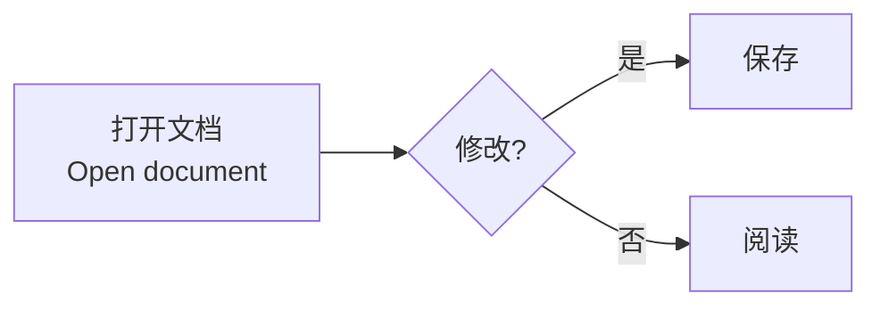

# Mermaid 原生图表

在 Markdown 中使用 `mermaid` 围栏即可在分栏预览、阅读及即时模式中显示图表。源码模式保留原始文本，修改后沿用现有后台渲染流程。Windows、Linux、Android 共用同一 Rust 图表实现，不使用 WebView，也不执行文档中的 JavaScript。

````markdown

````

## 本次覆盖

固定使用 merman 0.8.0-alpha.6，已增加以下基础语法的 SVG 和原生文档绘制测试：

- 流程图 `flowchart` / `graph`
- 时序图 `sequenceDiagram`
- 类图 `classDiagram`
- 状态图 `stateDiagram-v2`
- 实体关系图 `erDiagram`
- 甘特图 `gantt`
- 饼图 `pie`
- 用户旅程图 `journey`
- 思维导图 `mindmap`
- 时间线 `timeline`
- Git 图 `gitGraph`

测试还覆盖中文、多行 HTML 标签、浅色/深色结果分别缓存、深色背景像素回归，以及错误语法的显式诊断。图表画布透明，沿用文档背景。主题默认跟随阅读主题；图表自身的有效主题配置仍可覆盖默认值。

## 显示与导出

图表先经过 Merman 的 `resvg_safe` 管线，将浏览器专用的 `foreignObject` 标签转换为普通 SVG；随后使用本机字体生成文字矢量轮廓。这样原生阅读、静态 HTML 和 PDF 不依赖浏览器标签布局，也不会在打开导出文件时重新执行 Mermaid。

Windows 使用应用内的 Noto CJK 作为中日韩字体兜底；Linux 使用系统字体，精简环境需安装 Noto CJK；Android 显式加载 `/system/fonts` 与 `/product/fonts` 的系统字体。字体库按需初始化并缓存，图表结果沿用有容量上限的缓存。

HTML 内嵌图表 SVG，PDF 保留矢量形状。图表文字已经转换为路径，因此不能当作 PDF 普通正文逐字选择复制；Markdown 源码始终保留。导出不会把错误图表静默当成成功内容。

每次图表排版设置 5 秒协作式期限，后台执行；期限依赖引擎检查点，不是操作系统硬隔离。改变文档后的陈旧渲染结果仍由现有修订检查丢弃。

## 兼容边界

本次的常见类型测试不代表所有 Mermaid 版本、所有图表家族或所有语法已严格兼容。对固定 Mermaid 11.12.0 官方输出的布局与视觉对照仍未完成。自定义图标包、ELK 专用布局、外部图片资源、图表点击脚本、交互浏览器功能不在当前完成范围。复杂 HTML 标签样式可能与浏览器不同。

不支持或语法错误时显示明确错误及原文，保留编辑能力；这类结果不计作兼容通过。示例见 `packaging/smoke/mermaid.md`；最终包验证见 [PLATFORM-VALIDATION.md](PLATFORM-VALIDATION.md)。

```sh
cargo test -p hui-render --lib
hui --render packaging/smoke/mermaid.md mermaid.png
hui --render packaging/smoke/mermaid.md mermaid-dark.png dark
hui --render packaging/smoke/mermaid.md mermaid.html
hui --render packaging/smoke/mermaid.md mermaid.pdf
```
